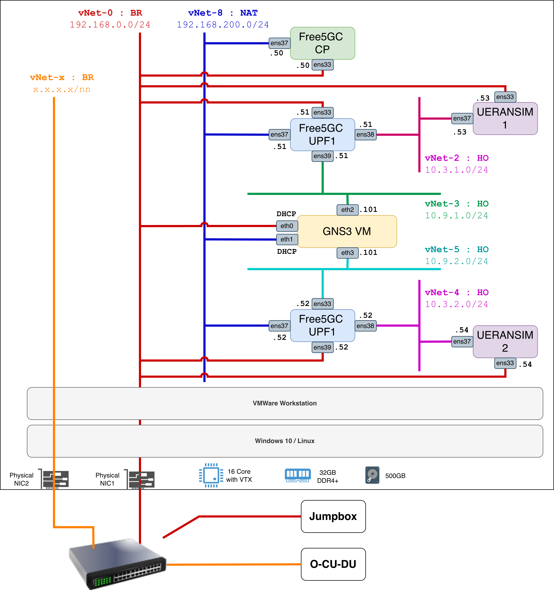

# N9-SDN-RAAS — Distributed free5GC / UERANSIM Lab

> **Scope:** VMware Workstation networking, a distributed free5GC control plane (CP) with two independently hosted UPFs, and two UERANSIM gNB/UE pairs. This README documents **slice-based UPF selection**, not an already operational N9 chain. The topology diagram is the source for VMware adapter mappings; the free5GC configuration and observed behaviour are drawn from the lab setup and test logs.



**Diagram note:** The bottom-right box is labelled **“Free5GC UPF1”** in the supplied diagram, but its `.52` addresses and connection to UERANSIM2 identify it as **UPF2** throughout this document. `vNet-x` and its `x.x.x.x/nn` network are placeholders, not an assigned subnet.

## 1. Architecture and network provisioning

The deployment contains five principal Ubuntu VMs on **VMware Workstation**:

- **free5gc-cp:** one instance of the free5GC service-based control plane (including AMF, SMF, NRF, NSSF, UDM, UDR, AUSF, PCF and other enabled network functions).
- **free5gc-upf1 / free5gc-upf2:** separate VMs running the free5GC UPF and `gtp5g` datapath.
- **ueransim-1 / ueransim-2:** each VM hosts one simulated gNB and one simulated UE. The two UEs have separate SUPIs and requested network slices.

An additional **GNS3 VM** is connected to the management/control networks and to two **N9 host-only networks**, intended to host the future SDN-managed transport between UPFs. The physical switch, separate bridged physical NIC and external jumpbox/O-CU-DU shown in the diagram are integration points; they are **not prerequisites for the initial two-UERANSIM slice test**.

### 1.1 VMware virtual networks

| VMware network | Type in diagram | IPv4 subnet | Role | Attached guest interfaces |
|---|---|---|---|---|
| **vNet-0** | Bridged (**BR**) | `192.168.0.0/24` | VM management; AMF N2/NGAP reachability; UPF N6 egress toward LAN/internet | CP `ens33`; UPF1 `ens33`; UPF2 `ens33`; UERANSIM1 `ens33`; UERANSIM2 `ens33`; GNS3 `eth0` (DHCP) |
| **vNet-8** | NAT | `192.168.200.0/24` | Private CP-to-UPF **N4 / PFCP** transport | CP `ens37`; UPF1 `ens37`; UPF2 `ens37`; GNS3 `eth1` (DHCP) |
| **vNet-2** | Host-only (**HO**) | `10.3.1.0/24` | **N3 / GTP-U** between UERANSIM1 gNB and UPF1 | UPF1 `ens38`; UERANSIM1 `ens37` |
| **vNet-4** | Host-only (**HO**) | `10.3.2.0/24` | **N3 / GTP-U** between UERANSIM2 gNB and UPF2 | UPF2 `ens38`; UERANSIM2 `ens37` |
| **vNet-3** | Host-only (**HO**) | `10.9.1.0/24` | UPF1-side **N9 / GTP-U** transport to GNS3 | UPF1 `ens39`; GNS3 `eth2` |
| **vNet-5** | Host-only (**HO**) | `10.9.2.0/24` | UPF2-side **N9 / GTP-U** transport to GNS3 | UPF2 `ens39`; GNS3 `eth3` |
| **vNet-x** | Bridged (**BR**) | *not specified* | Separate physical-NIC/switch integration for the external O-CU-DU system | No IP/interface allocation defined in the supplied diagram |

> **Networking terminology:** VMware **NAT mode** on `vNet-8` is a VM connectivity setting, **not** the UE's N6 internet NAT. The latter is configured on each UPF. A host-only switch does not, by itself, route between `10.9.1.0/24` and `10.9.2.0/24`.

### 1.2 Address and interface inventory

| VM | Interface | IP address | VMware network | Function |
|---|---|---|---|---|
| **free5gc-cp** | `ens33` | `192.168.0.50/24` | vNet-0 | Management, AMF N2 (`38412/SCTP`) |
| | `ens37` | `192.168.200.50/24` | vNet-8 | SMF N4 (`8805/UDP`) |
| **free5gc-upf1** | `ens33` | `192.168.0.51/24` | vNet-0 | Management / N6 egress |
| | `ens37` | `192.168.200.51/24` | vNet-8 | UPF PFCP / N4 |
| | `ens38` | `10.3.1.51/24` | vNet-2 | UPF N3 / GTP-U (`2152/UDP`) |
| | `ens39` | `10.9.1.51/24` | vNet-3 | UPF1-side N9 / GTP-U |
| **free5gc-upf2** | `ens33` | `192.168.0.52/24` | vNet-0 | Management / N6 egress |
| | `ens37` | `192.168.200.52/24` | vNet-8 | UPF PFCP / N4 |
| | `ens38` | `10.3.2.52/24` | vNet-4 | UPF N3 / GTP-U (`2152/UDP`) |
| | `ens39` | `10.9.2.52/24` | vNet-5 | UPF2-side N9 / GTP-U |
| **ueransim-1** | `ens33` | `192.168.0.53/24` | vNet-0 | gNB N2 / management |
| | `ens37` | `10.3.1.53/24` | vNet-2 | gNB N3 toward UPF1 |
| | `uesimtun0` | **SMF assigned**, `10.60.1.x` | Virtual TUN | UE1 PDU-session IP |
| **ueransim-2** | `ens33` | `192.168.0.54/24` | vNet-0 | gNB N2 / management |
| | `ens37` | `10.3.2.54/24` | vNet-4 | gNB N3 toward UPF2 |
| | `uesimtun0` | **SMF assigned**, `10.60.2.x` | Virtual TUN | UE2 PDU-session IP |
| **GNS3 VM** | `eth0` | DHCP / vNet-0 | vNet-0 | Management / external access |
| | `eth1` | DHCP / vNet-8 | vNet-8 | Control-side management/integration |
| | `eth2` | `10.9.1.101/24` | vNet-3 | N9 side connected to UPF1 |
| | `eth3` | `10.9.2.101/24` | vNet-5 | N9 side connected to UPF2 |

The GNS3 `.101` values are shown on the diagram. Confirm whether these addresses are set on the GNS3 VM itself or on attached GNS3 nodes before using them as next-hop gateways. **Do not assume the GNS3 VM automatically routes/bridges these two networks.**

### 1.3 Provisioning the virtual NICs in VMware Workstation

1. In **Virtual Network Editor**, create/configure `VMnet0` (bridged), `VMnet8` (NAT), and `VMnet2`, `VMnet3`, `VMnet4`, `VMnet5` (host-only) with the subnets in §1.1. VMware's UI typically uses the spelling **VMnet**; the diagram calls them **vNet**.
2. For each VM, use **VM Settings → Network Adapter → Custom: Specific virtual network** and assign adapters according to §1.2. Do **not** rely solely on the adapter order: match guest interface names with `ip -br addr` / `ip link` / MAC addresses after boot.
3. Configure the static guest IPv4 addresses shown in §1.2 using Ubuntu Netplan or your existing network manager. GNS3's `eth0` and `eth1` are labelled DHCP in the diagram.
4. Keep each host-only link in its **own** Layer-2 segment. The N3 networks must not be merged; they let captures identify each UE's access-side UPF independently.
5. For `ens33`, ensure that the physical bridged LAN supplies a usable **default route** and DNS if internet access is required. The actual LAN router address is **not specified by the diagram** (do not assume `192.168.0.1` without verifying it).
6. For the multi-homed CP/UPF VMs, do not add unnecessary default routes through N4/N3/N9. N4, N3 and N9 require connected subnet routes; N6 uses the LAN default route.

Verify on each guest:

```bash
ip -br address
ip route
ip route get 8.8.8.8                # on UPFs: should exit on ens33
```

Check **N4 reachability** from CP:

```bash
ping -c 3 192.168.200.51
ping -c 3 192.168.200.52
```

Check **N3 reachability** from each UERANSIM VM:

```bash
# ueransim-1
ping -c 3 10.3.1.51

# ueransim-2
ping -c 3 10.3.2.52
```

Check **N9 local-side reachability** (GNS3 connectivity only; not end-to-end N9 forwarding):

```bash
# On UPF1, if the diagram's eth2 address is live
ping -c 3 10.9.1.101

# On UPF2, if the diagram's eth3 address is live
ping -c 3 10.9.2.101
```

For future routed N9 transport, the SDN/GNS3 gateway and return routes must be configured explicitly. Example routes **only if** `.101` is actually a router on each side:

```bash
# UPF1
sudo ip route add 10.9.2.0/24 via 10.9.1.101 dev ens39
# UPF2
sudo ip route add 10.9.1.0/24 via 10.9.2.101 dev ens39
```

These static routes are **not needed for the independent slice-based UE-to-internet test**.

## 2. Distributed free5GC with two UPFs and two slices

### 2.1 Target service behaviour

The intent is **deterministic UPF eligibility based on S-NSSAI**, with two DNN-specific, nonoverlapping UE IP pools:

| Subscriber | Access VM | SUPI / IMSI | S-NSSAI (SST/SD) | DNN | Target UPF | Assigned pool |
|---|---|---|---|---|---|---|
| UE1 | ueransim-1 | `imsi-208930000000001` | `1 / 010203` | `internet` | UPF1 | `10.60.1.0/24` |
| UE2 | ueransim-2 | `imsi-208930000000002` | `1 / 112233` | `internet` | UPF2 | `10.60.2.0/24` |

Both subscribers use **PLMN 208/93**, **TAC `000001`**, and DNN **`internet`**. Different SD values identify the two slices, so the SMF can map each requested S-NSSAI/DNN to a different eligible UPF and address pool. **This is not gNB-based selection**: a UE's slice is the differentiating input, and the gNB-to-UPF tunnel endpoint must still be verified separately.

Observed working control-plane outcomes include SMF messages such as `Selected UPF: UPF1` and `Selected UPF: UPF2`; UE2 has been assigned `10.60.2.1`. **Known caveat:** the SMF has intermittently logged `Can't find UPF with DNN[internet] S-NSSAI[sst: 1 sd: 112233]` before selecting UPF2 successfully on a retry. This issue was **not resolved** by the NSSF tracking-area correction or by quoting SDs; do not present UPF selection as consistently reliable yet.

### 2.2 Software and deployment layout

- free5GC **v4.2.3** control-plane network functions run on **free5gc-cp** (`~/free5gc`).
- free5GC **UPF v4.2.3** runs separately on UPF1 and UPF2, with the `gtp5g` kernel module used for GTP-U forwarding (previously installed as `gtp5g v0.9.14` in this lab).
- UERANSIM **v3.3.0** runs on both UERANSIM VMs.
- CP WebConsole is accessed at `http://192.168.0.50:5000` when its process is running.
- The CP launcher is `~/free5gc/run-cp.sh`; it starts the CP NFs. The two remote UPFs must be started **on their own VMs**, not from the CP launcher.

Prerequisites: build/install these versions using the project's standard procedures; ensure `gtp5g` is loaded on each UPF (`lsmod | grep gtp5g`); verify VM routes/interfaces and that the WebConsole subscribers exist. This README focuses on the **lab-specific configuration**, not package compilation.

### 2.3 AMF: PLMN, TAC, N2 and supported slices

On **free5gc-cp**, update the relevant keys in `~/free5gc/config/amfcfg.yaml` (merge with existing SBI/security and other settings):

```yaml
configuration:
  ngapIpList:
    - 192.168.0.50
  # ... retain existing AMF settings ...
  servedGuamiList:
    - plmnId: {mcc: "208", mnc: "93"}
      amfId: cafe00
  supportTaiList:
    - plmnId: {mcc: "208", mnc: "93"}
      tac: "000001"
  plmnSupportList:
    - plmnId: {mcc: "208", mnc: "93"}
      snssaiList:
        - {sst: 1, sd: "010203"}
        - {sst: 1, sd: "112233"}
  supportDnnList:
    - internet
```

The snippet is **not a complete AMF file**. Leave NRF/SBI interfaces and existing authentication/security-related settings intact.

### 2.4 SMF: N4 and disjoint slice-to-UPF mappings

On **free5gc-cp**, edit `~/free5gc/config/smfcfg.yaml`. Ensure `configuration.snssaiInfos` advertises both slice/DNN combinations:

```yaml
snssaiInfos:
  - sNssai: {sst: 1, sd: "010203"}
    dnnInfos:
      - dnn: internet
        dns: {ipv4: 8.8.8.8}
  - sNssai: {sst: 1, sd: "112233"}
    dnnInfos:
      - dnn: internet
        dns: {ipv4: 8.8.8.8}
```

Keep the SMF N4 endpoint:

```yaml
pfcp:
  nodeID: 192.168.200.50
  listenAddr: 192.168.200.50
  externalAddr: 192.168.200.50
```

Use the following `configuration.userplaneInformation` **section**, merged into the existing SMF YAML:

```yaml
userplaneInformation:
  upNodes:
    gNB1:
      type: AN
    gNB2:
      type: AN

    UPF1:
      type: UPF
      nodeID: 192.168.200.51
      addr: 192.168.200.51
      sNssaiUpfInfos:
        - sNssai: {sst: 1, sd: "010203"}
          dnnUpfInfoList:
            - dnn: internet
              pools:
                - cidr: 10.60.1.0/24
      interfaces:
        - interfaceType: N3
          endpoints: [10.3.1.51]
          networkInstances: [internet]
        - interfaceType: N9
          endpoints: [10.9.1.51]
          networkInstances: [internet]

    UPF2:
      type: UPF
      nodeID: 192.168.200.52
      addr: 192.168.200.52
      sNssaiUpfInfos:
        - sNssai: {sst: 1, sd: "112233"}
          dnnUpfInfoList:
            - dnn: internet
              pools:
                - cidr: 10.60.2.0/24
      interfaces:
        - interfaceType: N3
          endpoints: [10.3.2.52]
          networkInstances: [internet]
        - interfaceType: N9
          endpoints: [10.9.2.52]
          networkInstances: [internet]

  links:
    - {A: gNB1, B: UPF1}
    - {A: gNB2, B: UPF2}
```

**Critical YAML note:** Always quote slice differentiators: `sd: "010203"` (a **string**). In one real diagnostic, unquoted `sd: 010203` was parsed as the integer `4227`. Confirm the values are strings before restarting the CP.

Also, `gNB1` and `gNB2` in the SMF's graph are **logical AN nodes**; declaring these links does not prove that free5GC v4.2.3 maps each incoming physical gNB to the corresponding graph node. Test the actual N3 tunnel endpoint in NGAP/PFCP captures.

### 2.5 NSSF: allow both slices in the actual tracking area

On **free5gc-cp**, adjust `~/free5gc/config/nssfcfg.yaml` so the same PLMN/slice combination appears in its `supportedPlmnList`, `supportedNssaiInPlmnList`, `nsiList` and `taList` (and any relevant availability mappings):

```yaml
supportedPlmnList:
  - {mcc: "208", mnc: "93"}

supportedNssaiInPlmnList:
  - plmnId: {mcc: "208", mnc: "93"}
    supportedSnssaiList:
      - {sst: 1, sd: "010203"}
      - {sst: 1, sd: "112233"}

nsiList:
  - snssai: {sst: 1, sd: "010203"}
    nsiInformationList:
      - nrfId: http://127.0.0.10:8000/nnrf-nfm/v1/nf-instances
        nsiId: 22
  - snssai: {sst: 1, sd: "112233"}
    nsiInformationList:
      - nrfId: http://127.0.0.10:8000/nnrf-nfm/v1/nf-instances
        nsiId: 23

taList:
  - tai:
      plmnId: {mcc: "208", mnc: "93"}
      tac: "000001"
    accessType: 3GPP_ACCESS
    supportedSnssaiList:
      - {sst: 1, sd: "010203"}
      - {sst: 1, sd: "112233"}
```

These are **sections within** `configuration:`, not an entire NSSF config. Keep the SBI and other required NSSF configuration. Remove unrelated sample PLMNs/TACs and stale AMF instance UUIDs if they are not used in this lab.

The original NSSF warning was `No TA {"plmnId":{"mcc":"208","mnc":"93"},"tac":"000001"} in NSSF configuration`. Aligning `taList` removed that warning and allowed NSSF to return `NsiInformation`, **but did not remove the separate intermittent SMF UPF-selection error**.

### 2.6 UPF1 and UPF2: PFCP, GTP-U and DNN ranges

On each UPF VM, edit `~/free5gc/config/upfcfg.yaml`. **UPF1** uses:

```yaml
pfcp:
  addr: 192.168.200.51
  nodeID: 192.168.200.51
  retransTimeout: 1s
  maxRetrans: 3

gtpu:
  forwarder: gtp5g
  ifList:
    - addr: 0.0.0.0
      type: N3
    - addr: 10.9.1.51
      type: N9

dnnList:
  - dnn: internet
    cidr: 10.60.1.0/24
```

**UPF2** uses:

```yaml
pfcp:
  addr: 192.168.200.52
  nodeID: 192.168.200.52
  retransTimeout: 1s
  maxRetrans: 3

gtpu:
  forwarder: gtp5g
  ifList:
    - addr: 0.0.0.0
      type: N3
    - addr: 10.9.2.52
      type: N9

dnnList:
  - dnn: internet
    cidr: 10.60.2.0/24
```

The lab previously used wildcard `0.0.0.0` for the UPF's N3 GTP-U listener. With both N3 and N9 GTP-U enabled, **verify the exact listener behaviour of your v4.2.3 UPF binary**; a wildcard listener may also receive N9 packets. SMF-advertised endpoints still distinguish the intended N3/N9 addresses. Keep N9 unprogrammed for the independent-UPF test.

Load/check `gtp5g` on each UPF:

```bash
sudo modprobe gtp5g
lsmod | grep gtp5g
```

Start each UPF using the run command appropriate to that VM's compiled installation (for example, from `~/free5gc`, `sudo ./bin/upf -c ./config/upfcfg.yaml` if supported by that binary). Verify the exact CLI flags with `./bin/upf -h` rather than assuming all versions use the same syntax.

### 2.7 UERANSIM: advertise and request a matching slice

On **ueransim-1**, retain the existing MCC/MNC (`208`/`93`), TAC (`1`), local radio link settings (`linkIp`/`gnbSearchList` for the co-resident simulated UE), and authentication credentials. Relevant entries in `~/UERANSIM/config/n9-gnb1.yaml`:

```yaml
mcc: '208'
mnc: '93'
tac: 1
ngapIp: 192.168.0.53
gtpIp: 10.3.1.53
amfConfigs:
  - address: 192.168.0.50
    port: 38412
slices:
  - sst: 1
    sd: 0x010203
```

In `config/n9-ue1.yaml`, keep `supi: 'imsi-208930000000001'` and use:

```yaml
configured-nssai:
  - sst: 1
    sd: 0x010203
default-nssai:
  - sst: 1
    sd: 0x010203
sessions:
  - type: IPv4
    apn: internet
    slice:
      sst: 1
      sd: 0x010203
```

On **ueransim-2**, use the corresponding N2 and N3 addresses in `config/n9-gnb2.yaml`:

```yaml
mcc: '208'
mnc: '93'
tac: 1
ngapIp: 192.168.0.54
gtpIp: 10.3.2.54
amfConfigs:
  - address: 192.168.0.50
    port: 38412
slices:
  - sst: 1
    sd: 0x112233
```

In `config/n9-ue2.yaml`, keep `supi: 'imsi-208930000000002'` and use:

```yaml
configured-nssai:
  - sst: 1
    sd: 0x112233
default-nssai:
  - sst: 1
    sd: 0x112233
sessions:
  - type: IPv4
    apn: internet
    slice:
      sst: 1
      sd: 0x112233
```

These are **partial snippets**: do not erase `key`, `op`/`opc`, `amf`, `imei`, `linkIp`, `gnbSearchList` and other required fields from working UERANSIM files. The `0x...` notation above is UERANSIM's requested SD representation; in free5GC YAML, use **quoted six-character SD strings**.

### 2.8 WebConsole: authorise each subscriber for its slice

In WebConsole (`http://192.168.0.50:5000`), create/edit the subscriptions matching the UERANSIM SUPIs and authentication credentials:

| Subscriber | PLMN | Allowed slice | DNN/session | Intended UPF pool |
|---|---|---|---|---|
| `imsi-208930000000001` | 208/93 | SST `1`, SD `010203` | `internet`, IPv4 | `10.60.1.0/24` |
| `imsi-208930000000002` | 208/93 | SST `1`, SD `112233` | `internet`, IPv4 | `10.60.2.0/24` |

Provisioning a subscriber slice **authorises** access; the SMF's `userplaneInformation` determines its **candidate UPF(s)** and IP pools.

### 2.9 `uerouting.yaml` and `run-cp.sh`

For this two-independent-UPF slice test, the configuration does **not** require a UE-specific chained N9 path. Do not import the reference project's `gNB1 → UPF1 → UPF2` topology into `uerouting.yaml`. A minimal `uerouting.yaml` for this test is:

```yaml
info:
  version: 1.0.7
  description: Independent slice-based UPF selection
ueRoutingInfo: {}
routeProfile: {}
pfdDataForApp: []
```

The CP launcher **does not require a per-UE change** just to select the slice. It must launch the SMF against the intended `config/smfcfg.yaml` and NSSF against `config/nssfcfg.yaml`; the SMF reads its routing configuration as part of startup. Confirm actual process arguments, working directory and log paths in your existing `run-cp.sh` before changing it.

### 2.10 Startup and validation procedure

1. Start both standalone UPFs, confirming their PFCP listeners on `192.168.200.51:8805` and `192.168.200.52:8805`.
2. Start CP NFs from `~/free5gc` with `./run-cp.sh`; ensure **only one** active SMF process and both UPF PFCP Association Setup Accepted events.
3. Start each UERANSIM gNB with its `n9-gnb*.yaml`, then each UE with its `n9-ue*.yaml`.
4. Confirm successful Registration and **PDU Session Establishment Accept** on each UE.
5. Check that `uesimtun0` has an address from the intended subnet and correlate it with **SMF `Selected UPF`**, **PFCP Session Establishment destination**, and **NGAP N3 tunnel endpoint**.

Example commands:

```bash
# CP: associations, selection and errors
grep -Ei 'association|Selected UPF|Allocated UE IP|Can.t find UPF' \
  ~/free5gc/log/cp/smf.log | tail -80

# UE1 and UE2, on their respective VMs
ip -br addr show uesimtun0

# CP: capture fresh PFCP sessions while restarting a UE
sudo tcpdump -ni ens37 -w /tmp/upf-selection.pcap udp port 8805

# Each UPF: capture N3 while generating UE traffic
sudo tcpdump -ni ens38 udp port 2152
```

**Successful expected selections:**

```text
UE1: S-NSSAI 1/010203 → SMF selects UPF1 (192.168.200.51) → 10.60.1.x
UE2: S-NSSAI 1/112233 → SMF selects UPF2 (192.168.200.52) → 10.60.2.x
```

**Known unresolved selection issue:** Test logs show an eligible UPF sometimes cannot be found for `1/112233` even after PFCP association succeeded; retries later select UPF2 and allocate `10.60.2.1`. In older logs, UPF2 also experienced PFCP retry timeouts/recovery-timestamp changes. Inspect SMF selection logic and the UPF process/state rather than assuming NSSF is still at fault. Do not claim deterministic/reliable selection until repeated clean-session tests pass.

### 2.11 N6 internet connectivity: a separate forwarding task

PDU-session establishment and an IP on `uesimtun0` **do not imply internet reachability**. After validating N3, configure IPv4 forwarding and source NAT independently on both UPF VMs. First verify their `ens33` default-route egress and direct internet connectivity:

```bash
ip route get 8.8.8.8
ping -c 3 8.8.8.8
sudo sysctl -w net.ipv4.ip_forward=1
```

Illustrative **manual** NAT commands, to be run on the relevant UPF and adapted if firewall policy differs:

```bash
# UPF1 ONLY
sudo iptables -t nat -C POSTROUTING -s 10.60.1.0/24 -o ens33 -j MASQUERADE 2>/dev/null || \
  sudo iptables -t nat -A POSTROUTING -s 10.60.1.0/24 -o ens33 -j MASQUERADE

# UPF2 ONLY
sudo iptables -t nat -C POSTROUTING -s 10.60.2.0/24 -o ens33 -j MASQUERADE 2>/dev/null || \
  sudo iptables -t nat -A POSTROUTING -s 10.60.2.0/24 -o ens33 -j MASQUERADE
```

Also permit UE egress and **ESTABLISHED,RELATED** return traffic in each UPF's FORWARD chain according to local firewall policy, and verify the gtp5g datapath. Use **either** manual iptables NAT **or** version-verified UPF-managed NAT options (`natifname`), not both. These example rules alone are not a guarantee of functional forwarding.

Test from each UERANSIM VM:

```bash
ping -I uesimtun0 -c 4 8.8.8.8
```

If unsuccessful, capture `udp port 2152` on `ens38` and `icmp` on `ens33` of the selected UPF. **N6 connectivity and end-to-end UE-to-internet forwarding had not yet been confirmed at the time of writing.**

## 3. Independent slice selection versus the reference chained-UPF project

A separate reference testbed was supplied for comparison. Its diagram depicts a two-O-DU/O-CU radio arrangement and a forwarding chain:

```text
UE(s) → O-DU / O-CU (gNB1 logical AN) → UPF1 → N9 → UPF2 → N6 → DN
```

The reference `smfcfg.ulcl.yaml` advertises **one AN node (`gNB1`)**, and defines `links`:

```yaml
links:
  - {A: gNB1, B: UPF1}
  - {A: UPF1, B: UPF2}
```

Its reference `uerouting.yaml` lists **both UE1 and UE2 on the same** `gNB1 → UPF1 → UPF2` path. The reference SMF declares a UE IP `pools` entry at **UPF2** (`10.60.0.0/16`) but not at intermediate UPF1. Its SMF also sets `ulcl: true`; the reference UPF2 listens on **N9** while its N3 listener is commented out. These are all consistent with **UPF1 as an intermediate UPF and UPF2 as a downstream PDU Session Anchor (PSA)**. They are **not evidence of two independent UE-to-UPF selections**.

| Dimension | **This lab: two independent slices** | **Reference: chained UPFs** |
|---|---|---|
| Selection criterion | UE-requested S-NSSAI / DNN | Predefined multi-UPF topology for both UEs |
| Network slices | Two: `1/010203`, `1/112233` | Reference SMF primarily describes slice 1/default and `1/112233`; both UEs share the chain |
| UE access paths | `gNB1 → UPF1`; `gNB2 → UPF2` (intended) | `gNB1 → UPF1 → UPF2` (both UEs) |
| N3 termination | Each UPF has its own dedicated N3 subnet | UPF1 is the access-facing UPF |
| N9 requirement | Not needed for initial independent selection | Required between UPF1 and UPF2 |
| UE IP pools | UPF1 `10.60.1.0/24`; UPF2 `10.60.2.0/24` | UPF2 `10.60.0.0/16` in SMF anchor declaration |
| Downstream N6 access | Each UPF independently targeted for N6 | UPF2 is downstream of N9 toward DN |
| Main research question | Can one SMF isolate UEs by requested slice and anchor each session at a distinct UPF? | Can one session traverse successive UPFs through N9? |

**Why this lab chose the two-slice approach:** Earlier tests with both UEs on the same S-NSSAI/DNN assigned both from the `10.60.1.0/24` pool; declaring separate `gNB1`/`gNB2` graph links and editing `uerouting.yaml` did not reliably disambiguate UPF selection. Distinct slices make candidate UPF eligibility explicit. This is an independent-anchor **baseline**, not a substitute for the later GNS3/OVS-controlled N9 inter-UPF chain or UE-to-UE routing.

## 4. Operational checkpoints and open issues

| Checkpoint | State in recorded tests |
|---|---|
| Both remote UPFs can PFCP-associate with the SMF | **Observed**, though transient recovery/timeout events have occurred |
| UE1 registers and obtains a PDU-session IP in `10.60.1.0/24` | **Observed** |
| UE2 requests `1/112233`, SMF selects UPF2, obtains `10.60.2.1` | **Observed on successful retry** |
| NSSF recognises PLMN `208/93`, TAC `000001` | **Observed after correction** |
| SMF selects UPF2 reliably on *first* attempt | **Unresolved — intermittent `Can't find UPF`** |
| Actual gNB2 ↔ UPF2 N3 packet forwarding | **Not yet confirmed by capture** |
| Internet access through each UPF's N6 | **Not yet confirmed** |
| N9 routed through GNS3/OVS/SDN controller | **Planned, not configured/validated here** |

## 5. Useful checks

```bash
# CP — is SMF unique and using the intended config?
pgrep -af '/bin/smf'

# CP — verify slice data types before restart
python3 - <<'PY'
import yaml
c = yaml.safe_load(open('config/smfcfg.yaml'))['configuration']
for name in ('UPF1', 'UPF2'):
    for item in c['userplaneInformation']['upNodes'][name]['sNssaiUpfInfos']:
        sd = item['sNssai']['sd']
        print(name, repr(sd), type(sd).__name__)
PY

# UPFs — PFCP UDP port and kernel module
sudo ss -lunp | grep 8805
lsmod | grep gtp5g

# UERANSIM VMs — assigned PDU address
ip -br addr show uesimtun0

# UPFs — N6 route and NAT counters
ip route get 8.8.8.8
sudo iptables -t nat -L POSTROUTING -n -v
```

### Implementation notes

- Always take a backup before editing live configs; restart the relevant NF/UPF after changing YAML.
- Preserve UERANSIM authentication values and subscription credentials; they are deliberately **not** repeated in this README.
- No fixed GNS3 N9 next-hop router was confirmed; the `.101` addresses are shown in the diagram but may be endpoints rather than forwarding nodes.
- The VMware diagram references external O-CU-DU and jumpbox attachments. Their IP configuration, virtual-switch mappings and control-plane integration were **not** specified in the supplied materials.
- The goal of this stage is **slice-scoped UPF anchor selection and independent N6 forwarding**. **N9 SDN orchestration is a later milestone.**
